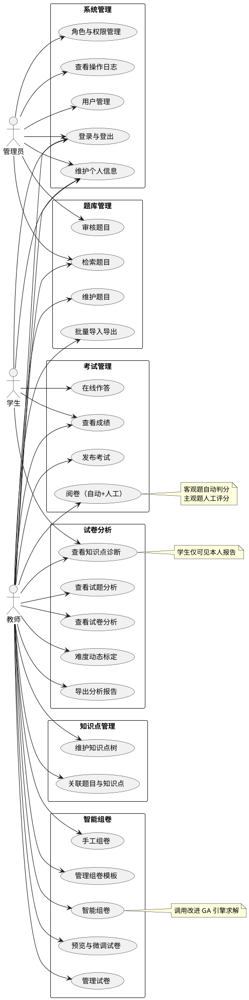
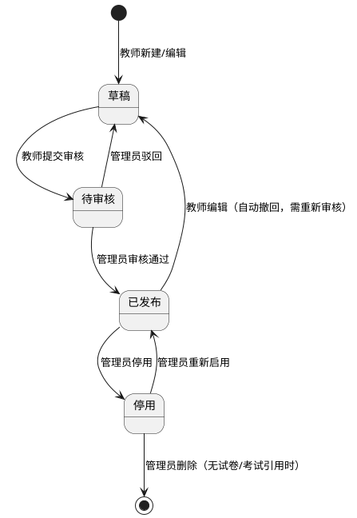

# 需求规格说明书

> 版本：v1.0　更新日期：2026-11-06
> 阶段：阶段 2 · W1（需求细化）
> 依据：[开题报告](../02-开题/开题报告.docx)、[项目整体规划](../01-规划/项目整体规划.md)、[项目执行计划](../01-规划/项目执行计划.md)
> 下游文档：数据库设计（W2）、接口设计（W3）以本文需求编号（FR-xx）为输入，不得遗漏或私自扩展。

---

## 一、引言

### 1.1 目的与范围

本文定义"智能组卷与试卷分析系统"的功能需求与非功能需求，作为后续数据库设计、接口设计、编码实现与测试验收的唯一依据。

系统面向单学科教学场景（如高校某门课程），支撑「题库 — 组卷 — 考试 — 评阅 — 分析 — 反馈」闭环：教师维护题库与知识点，通过模板与改进遗传算法完成智能组卷，发布考试后学生在线作答，系统自动评阅客观题、教师人工评阅主观题，最后基于经典测量理论（CTT）输出试卷质量分析与知识点掌握诊断。

### 1.2 术语与缩写

| 术语 | 说明 |
|---|---|
| 组卷 | 从题库中按约束条件选取题目组成试卷的过程 |
| 模板 | 预定义的组卷约束集合（题型数量、分值、知识点范围、难度分布等） |
| GA | 遗传算法（Genetic Algorithm），本系统中智能组卷的求解方法 |
| 改进 GA | 引入自适应交叉/变异概率、按题型分段交叉、精英保留的 GA |
| 适应度 | 衡量试卷满足各项约束与目标的综合评分，越高越好 |
| CTT | 经典测量理论（Classical Test Theory） |
| 难度 P | 题目得分率，P 越高题目越容易 |
| 区分度 D | 高分组与低分组得分率之差，衡量题目区分考生水平的能力 |
| 信度 | 试卷测量结果的稳定性，用 KR-20 或 Cronbach's α 计算 |
| 适应度阈值 | 算法终止条件之一，达到目标质量即停止进化 |

### 1.3 参考文档

1. 《基于 Spring Boot 的智能组卷与试卷分析系统》开题报告
2. 《项目整体规划》§二（系统功能蓝图）、§五（算法方案）、§六（分析方案）
3. 《项目阶段执行计划》阶段 2 验收标准

---

## 二、总体描述

### 2.1 系统定位

前后端分离的 B/S 系统，核心价值有两点：一是用改进遗传算法把"人工组卷数小时"压缩为"配置模板后数秒生成"，并让试卷的难度分布与知识点覆盖可量化、可控；二是把考试后的作答数据转化为试题质量指标（难度、区分度、信度）与知识点掌握诊断，形成教学反馈闭环。

### 2.2 用户角色

| 角色 | 定位 | 核心诉求 |
|---|---|---|
| 管理员 | 系统维护者 | 用户与权限管理、题目审核、操作可追溯 |
| 教师 | 主要使用者 | 高效组出质量可控的试卷、看得懂的试卷分析 |
| 学生 | 终端使用者 | 顺利参加考试、查看本人成绩与薄弱知识点 |

### 2.3 权限矩阵

| 功能域 | 管理员 | 教师 | 学生 |
|---|---|---|---|
| 用户 / 角色 / 日志管理 | ✔ | — | — |
| 个人信息维护 | ✔ | ✔ | ✔ |
| 知识点管理 | ✔（查看） | ✔（维护） | — |
| 题库管理 | ✔（审核、检索） | ✔（维护、提交审核） | — |
| 组卷（手工/模板/智能） | — | ✔ | — |
| 考试发布与阅卷 | — | ✔ | — |
| 在线作答 | — | — | ✔ |
| 试卷分析 | ✔（查看） | ✔（全部） | ✔（仅本人报告） |

### 2.4 运行环境与约束

1. PC 浏览器访问（Chrome / Edge），不做移动端适配（见 §8 范围外）。
2. 部署于单机/内网环境：Spring Boot + MySQL 8.0 + Redis，Nginx 反向代理。
3. 按**单学科**场景设计，知识点树以该学科为根；多学科为范围外扩展点。
4. 题干与解析为纯文本（富文本、图片、公式编辑器为范围外）。

---

## 三、用例模型

### 3.1 用例图

### 3.2 用例清单

| 用例编号 | 用例名称 | 参与者 | 所属模块 | 优先级 |
|---|---|---|---|---|
| UC-01 | 登录与登出 | 全部角色 | 系统管理 | 高 |
| UC-02 | 用户管理 | 管理员 | 系统管理 | 高 |
| UC-03 | 角色与权限管理 | 管理员 | 系统管理 | 高 |
| UC-04 | 查看操作日志 | 管理员 | 系统管理 | 中 |
| UC-05 | 维护个人信息 | 全部角色 | 系统管理 | 高 |
| UC-06 | 维护题目 | 教师 | 题库管理 | 高 |
| UC-07 | 检索题目 | 管理员、教师 | 题库管理 | 高 |
| UC-08 | 批量导入导出题目 | 教师 | 题库管理 | 中 |
| UC-09 | 审核题目 | 管理员 | 题库管理 | 高 |
| UC-10 | 维护知识点树 | 教师 | 知识点管理 | 高 |
| UC-11 | 关联题目与知识点 | 教师 | 知识点管理 | 高 |
| UC-12 | 手工组卷 | 教师 | 智能组卷 | 高 |
| UC-13 | 管理组卷模板 | 教师 | 智能组卷 | 高 |
| UC-14 | 智能组卷 | 教师 | 智能组卷 | 高 |
| UC-15 | 预览与微调试卷 | 教师 | 智能组卷 | 高 |
| UC-16 | 管理试卷 | 教师 | 智能组卷 | 中 |
| UC-17 | 发布考试 | 教师 | 考试管理 | 高 |
| UC-18 | 在线作答 | 学生 | 考试管理 | 高 |
| UC-19 | 阅卷（自动+人工） | 教师（自动判分由系统执行） | 考试管理 | 高 |
| UC-20 | 查看成绩 | 教师、学生 | 考试管理 | 高 |
| UC-21 | 查看试题分析 | 教师 | 试卷分析 | 高 |
| UC-22 | 查看试卷分析 | 教师 | 试卷分析 | 高 |
| UC-23 | 查看知识点诊断 | 教师、学生 | 试卷分析 | 高 |
| UC-24 | 导出分析报告 | 教师 | 试卷分析 | 低 |
| UC-25 | 难度动态标定 | 教师（系统给出建议） | 试卷分析 | 中 |

---

## 四、功能需求

> 优先级：高 = 闭环必需；中 = 增强，可随进度延后；低 = 可选项（答辩前完成加分为主）。
> 每条需求均标注对应用例，构成需求—用例追溯矩阵。

### 4.1 系统管理（FR-SM）

| 编号 | 需求名称 | 描述与验收要点 | 优先级 | 用例 |
|---|---|---|---|---|
| FR-SM-01 | 登录与登出 | 用户名 + 密码登录，签发 JWT；失败提示统一为"用户名或密码错误"（不暴露账号是否存在）；登出后 Token 失效；登录后按角色加载菜单。 | 高 | UC-01 |
| FR-SM-02 | 用户管理 | 管理员增删改查用户，启用/禁用账号、重置密码；用户名唯一；删除用户保留其历史数据（逻辑删除）。 | 高 | UC-02 |
| FR-SM-03 | 角色与权限管理 | 预置管理员/教师/学生三角色；角色可配置菜单与操作权限；权限在接口层校验，越权返回 403。 | 高 | UC-03 |
| FR-SM-04 | 操作日志 | 自动记录用户、题库、组卷、考试、阅卷等关键写操作（时间、操作人、动作、对象）；管理员可按条件查询。 | 中 | UC-04 |
| FR-SM-05 | 个人信息维护 | 查看与修改本人资料；修改密码需校验旧密码。 | 高 | UC-05 |

### 4.2 题库管理（FR-QB）

| 编号 | 需求名称 | 描述与验收要点 | 优先级 | 用例 |
|---|---|---|---|---|
| FR-QB-01 | 题目维护 | 支持单选、多选、判断、填空、简答 5 种题型的增删改查；必填校验：题型、题干、答案、默认分值、难度、主知识点。 | 高 | UC-06 |
| FR-QB-02 | 题目检索 | 按题型、难度、知识点、状态、关键词组合查询，分页返回；查询条件可清空重置。 | 高 | UC-07 |
| FR-QB-03 | 批量导入导出 | 按 Excel 模板批量导入（逐行校验，返回失败行号与原因，成功的行入库）；按当前检索结果导出。 | 中 | UC-08 |
| FR-QB-04 | 题目审核 | 教师创建/编辑题目后提交审核；管理员可通过或驳回；**仅"已发布"状态的题目可被组卷**。 | 高 | UC-09 |
| FR-QB-05 | 难度与知识点维护 | 难度取值 1–5；主知识点必填（必须为叶子节点），辅助知识点最多 2 个；随题目一起维护。 | 高 | UC-06 |
| FR-QB-06 | 选项与解析 | 客观题维护 2–6 个选项并指定正确答案；所有题型可维护解析文本；JSON 形式存储，便于扩展。 | 高 | UC-06 |

### 4.3 知识点管理（FR-KP）

| 编号 | 需求名称 | 描述与验收要点 | 优先级 | 用例 |
|---|---|---|---|---|
| FR-KP-01 | 知识点树维护 | 支持 2–3 级树结构；新增/编辑/删除/同级排序；有子节点或已关联题目时禁止删除并提示原因。 | 高 | UC-10 |
| FR-KP-02 | 题目—知识点关联 | 随题目维护（见 FR-QB-05）；支持按知识点反查题目列表，为组卷的知识点约束提供数据基础。 | 中 | UC-11 |

### 4.4 智能组卷（FR-PG）

| 编号 | 需求名称 | 描述与验收要点 | 优先级 | 用例 |
|---|---|---|---|---|
| FR-PG-01 | 手工组卷 | 按题型分组浏览题库，勾选题目加入试卷；实时显示当前总分与各题型题量。 | 高 | UC-12 |
| FR-PG-02 | 模板管理 | 模板包含：各题型数量与每题分值、试卷总分、知识点范围、难度分布比例（易:中:难）、目标答题时长；可保存、复用、编辑。 | 高 | UC-13 |
| FR-PG-03 | 智能组卷 | 基于模板调用改进 GA 求解；组卷前预检查题库题量是否满足约束（不足则直接提示具体缺口）；生成成功返回试卷与质量指标（难度分布、知识点覆盖率、适应度）；单次求解上限 10 秒，超时返回失败并提示放宽约束。 | 高 | UC-14 |
| FR-PG-04 | 预览与微调 | 整卷预览；换题（限同题型、同分值、难度相近）与题序调整；微调后质量指标实时重算。 | 高 | UC-15 |
| FR-PG-05 | 试卷管理 | 试卷列表、查看、复制、删除；被考试引用的试卷禁止删除。 | 中 | UC-16 |
| FR-PG-06 | 组卷质量反馈 | 生成结果与模板目标对比展示：难度分布（目标 vs 实际）、知识点覆盖率、预计答题时长，图表呈现。 | 中 | UC-14 |

### 4.5 考试管理（FR-EX）

| 编号 | 需求名称 | 描述与验收要点 | 优先级 | 用例 |
|---|---|---|---|---|
| FR-EX-01 | 考试发布 | 选择试卷，设置考试名称、起止时间、参考班级/学生；发布后学生在时间窗内可见并可进入考试。 | 高 | UC-17 |
| FR-EX-02 | 在线作答 | 倒计时（到时自动交卷）；答案自动保存（每 30 秒或切题时）；断线重连可恢复作答进度；手动交卷需二次确认。 | 高 | UC-18 |
| FR-EX-03 | 自动评阅 | 交卷后客观题按标准答案自动判分；判分规则见 §5.1；人工调整分数需记录操作人。 | 高 | UC-19 |
| FR-EX-04 | 人工阅卷 | 主观题逐题打分（0 至满分），支持填写评语；提供"按学生"与"按题号"两种阅卷视图。 | 高 | UC-19 |
| FR-EX-05 | 成绩管理 | 教师查看班级成绩列表与统计（均分、最高、最低、及格率）；学生查看本人成绩与各题得分、解析。 | 高 | UC-20 |
| FR-EX-06 | 作答数据留存 | 完整保存每题作答明细（答案、得分、是否人工调整），供试卷分析模块使用；数据只增不改（修正走日志）。 | 高 | UC-19 |

### 4.6 试卷分析（FR-AN）

| 编号 | 需求名称 | 描述与验收要点 | 优先级 | 用例 |
|---|---|---|---|---|
| FR-AN-01 | 试题分析 | 计算每题难度 P（得分率）与区分度 D（高/低分组各取 27% 后得分率之差）；列表 + 难度排序散点图；样本量 < 30 时标注"样本不足，指标仅供参考"。 | 高 | UC-21 |
| FR-AN-02 | 试卷分析 | 信度：题干为二分题的试卷用 KR-20，含主观题的试卷用 Cronbach's α；分数分布直方图、平均分、标准差、及格率；效度以"知识点覆盖与考试大纲对照"形式说明（内容效度，不做统计效度）。 | 高 | UC-22 |
| FR-AN-03 | 知识点诊断 | 按知识点聚合得分率，输出班级/学生两级雷达图与薄弱知识点清单（得分率 < 60% 列为薄弱）；学生仅可见本人诊断结果。 | 高 | UC-23 |
| FR-AN-04 | 报告导出 | 将分析报告导出为 Excel；图表截图导出为可选项。 | 低 | UC-24 |
| FR-AN-05 | 难度动态标定 | 题目累计有效作答样本 ≥ 30 时，按实测 P 值给出难度修正建议；教师确认后更新题目难度；修正记录可追溯。 | 中 | UC-25 |

---

## 五、题库数据规格

### 5.1 题型规格

| 题型 | 代码 | 属性 | 选项 | 判分规则 |
|---|---|---|---|---|
| 单选题 | `single` | 客观 | 2–6 个，1 个正确 | 选对得满分，否则 0 分 |
| 多选题 | `multiple` | 客观 | 2–6 个，≥2 个正确 | 全对得满分，否则 0 分（简化规则，不做部分给分） |
| 判断题 | `true_false` | 客观 | 固定"正确/错误" | 选对得满分，否则 0 分 |
| 填空题 | `fill` | 客观 | 无 | 与标准答案精确匹配（忽略首尾空格）；支持配置多个可接受答案 |
| 简答题 | `essay` | 主观 | 无 | 人工按要点评分（0 至该题满分） |

### 5.2 难度等级

| 等级 | 名称 | 含义 | 组卷默认目标 |
|---|---|---|---|
| 1 | 易 | 基础识记，大多数学生可答对 | 易（1–2 级）约占 30% |
| 2 | 较易 | 简单理解与应用 | 同上 |
| 3 | 中 | 常规应用与分析 | 中（3 级）约占 50% |
| 4 | 较难 | 综合应用 | 难（4–5 级）约占 20% |
| 5 | 难 | 高综合、高区分 | 同上 |

> 难度初值由教师标注；累计样本 ≥ 30 后可按 FR-AN-05 动态标定修正。组卷模板中的难度分布可自定义，上表为默认值（对应整体规划"易:中:难 = 3:5:2"）。

### 5.3 知识点规格

1. 树形结构，2–3 级（学科 → 章 → 节），仅**叶子节点**可挂题目。
2. 每题关联 1 个主知识点（必填）+ 至多 2 个辅助知识点。
3. 组卷的知识点约束按"指定叶子节点集合"定义，覆盖率 = 已覆盖知识点数 / 要求覆盖数。

### 5.4 题目状态流转

规则说明：

1. 仅"已发布"状态可参与组卷；"停用"题目不参与组卷与新考试，历史数据保留。
2. 已组卷的试卷保存**题目快照**（题干、选项、答案、分值的副本），后续题目修改不影响已生成试卷——保证试卷可复现。
3. 编辑已发布题目会自动撤回为草稿，避免"试卷引用与题库不一致"。

### 5.5 题目核心字段（为 W2 数据库设计提供输入）

| 字段 | 类型（建议） | 说明 |
|---|---|---|
| type | 枚举 | 题型，见 §5.1 |
| stem | TEXT | 题干 |
| options | JSON | 选项（客观题）：`[{key,text}]` |
| answer | JSON | 标准答案：客观题为选项 key 数组/布尔/文本；简答为空 |
| analysis | TEXT | 解析（可空） |
| difficulty | TINYINT | 1–5 |
| cognitive_level | 枚举（可空） | 识记/理解/应用/综合（不参与组卷约束，预留） |
| default_score | DECIMAL | 默认分值（试卷中可被模板覆盖） |
| status | 枚举 | 草稿/待审核/已发布/停用 |
| knowledge_id | BIGINT | 主知识点（叶子节点） |
| aux_knowledge_ids | JSON | 辅助知识点（≤2） |
| created_by / created_at / updated_at | — | 审计字段 |

---

## 六、非功能需求

| 编号 | 类别 | 需求描述（验收指标） | 验证方式 |
|---|---|---|---|
| NFR-P-01 | 性能 | 题库 500 题规模下，30 题试卷的智能组卷用时 ≤ 5 秒（超时上限 10 秒）；W8 实验数据佐证 | 性能测试 |
| NFR-P-02 | 性能 | 常规列表/详情接口响应 ≤ 2 秒（本地环境） | 手工/Postman |
| NFR-P-03 | 性能 | 50 名考生同时在线作答不出现接口错误（测试环境，可用并发脚本模拟） | 并发测试 |
| NFR-S-01 | 安全 | JWT 认证；密码 BCrypt 加盐存储；Token 过期自动跳转登录 | 代码审查 + 测试 |
| NFR-S-02 | 安全 | 接口级 RBAC 鉴权：学生不能访问组卷/题库写接口，越权返回 403 | 越权测试用例 |
| NFR-S-03 | 安全 | **防作弊**：考试进行中下发的试卷数据不包含正确答案与解析；交卷后才可查看 | 抓包/接口检查 |
| NFR-S-04 | 安全 | 参数校验齐全；SQL 全部参数化（MyBatis-Plus）；用户输入做 XSS 转义 | 代码审查 |
| NFR-C-01 | 兼容性 | Chrome / Edge 最近两个大版本可正常使用 | 手工验证 |
| NFR-C-02 | 兼容性 | 1366×768 及以上分辨率布局不破版 | 手工验证 |
| NFR-U-01 | 易用性 | 全中文界面；操作有明确成功/失败反馈；危险操作二次确认 | 走查 |
| NFR-M-01 | 可维护性 | 分层清晰（Controller/Service/Mapper）；文档与实现同步更新 | 代码审查 |
| NFR-D-01 | 数据一致性 | 组卷落库、交卷计分使用事务；交卷接口幂等（重复提交不重复计分） | 测试用例 |

---

## 七、需求追溯

### 7.1 模块 ↔ 开题研究内容

| 开题研究内容（3.1） | 对应模块 | 对应需求 |
|---|---|---|
| （1）题库与知识体系建模 | 题库管理、知识点管理 | FR-QB-01 ~ 06、FR-KP-01 ~ 02 |
| （2）智能组卷算法研究与实现 | 智能组卷 | FR-PG-03、FR-PG-06 |
| （3）组卷约束与模板管理 | 智能组卷 | FR-PG-01 ~ 05 |
| （4）试卷分析模块 | 试卷分析 | FR-AN-01 ~ 05 |
| （5）系统设计与实现 | 全部（系统管理、考试管理为工程支撑） | FR-SM-01 ~ 05、FR-EX-01 ~ 06 |

### 7.2 开题关键问题 ↔ 需求

| 关键问题（开题 §6） | 落点 |
|---|---|
| 6.1 多约束建模与适应度函数设计 | FR-PG-02（模板即约束配置）、FR-PG-03（GA 求解）、FR-PG-06（质量反馈） |
| 6.2 编码方式与算子改进 | FR-PG-03（改进 GA 引擎），算法细节在《算法设计》文档 |
| 6.3 难度与知识点的标注与标定 | FR-QB-05（标注）、FR-KP-01 ~ 02（关联）、FR-AN-05（P 值动态标定） |
| 6.4 分析模型建立与可视化 | FR-AN-01 ~ 04 |

### 7.3 W1 验收自检

| 验收标准 | 满足情况 |
|---|---|
| 每条需求可追溯到用例 | ✅ 每个 FR 均标注 UC 编号（§四） |
| 6 模块无遗漏 | ✅ §4.1–4.6 与整体规划 §二一致 |
| 与开题"拟解决的关键问题"一一对应 | ✅ §7.2 覆盖 6.1–6.4 |

---

## 八、需求优先级与范围界定

**高优先级（必做，闭环核心）**：FR-SM-01/02/03/05、FR-QB-01/02/04/05/06、FR-KP-01、FR-PG-01/02/03/04、FR-EX-01 ~ 06、FR-AN-01/02/03。

**中优先级（增强，进度紧时延后）**：FR-SM-04、FR-QB-03、FR-KP-02、FR-PG-05/06、FR-AN-05。

**低优先级（可选）**：FR-AN-04。

**明确不做（Won't，答辩被问"为什么不做"时的理由）**：

1. 移动端适配——场景为机房/PC 考试，投入产出比低。
2. 主观题 AI 自动评分——超出本科毕设范围，人工阅卷已满足闭环。
3. IRT / 认知诊断模型——样本量与理论门槛高，CTT 已足够支撑分析目标（开题已论证此选择）。
4. 多学科 / 多租户——范围控制，单学科即可验证全部核心功能。
5. 富文本、图片题、公式编辑器——纯文本题干可覆盖验证场景。
6. 多选题部分给分——判分规则简化，先保闭环正确性。

---

## 九、变更记录

| 日期 | 版本 | 变更内容 | 原因 |
|---|---|---|---|
| 2026-11-06 | v1.0 | 初版：角色、用例、6 模块功能需求、题库规格、非功能需求与追溯 | 执行计划 W1 交付 |
